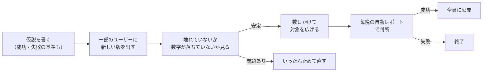
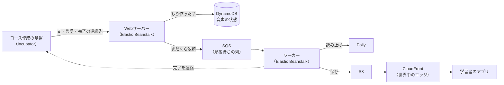
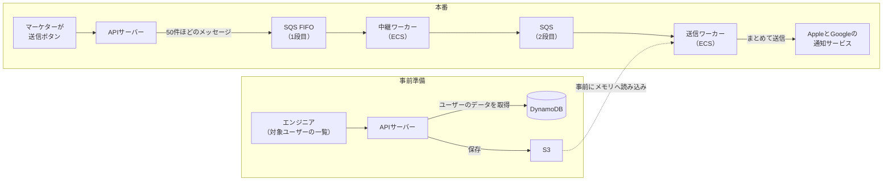
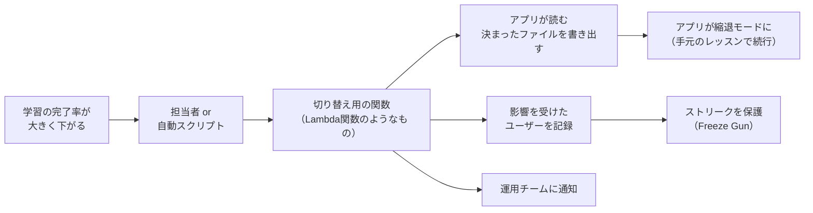

> Duolingo歴936日のCLF学習者が、大好きなアプリの裏側をAWS用語で読み解いてみた学習ログです。

## 0. はじめに

Duolingo、大好きです。ストリークは執筆時点で936日。大阪のDuomartにも1時間半並びました。

一方で、内定先がAWSを使っているので、CLF（AWS認定 Cloud Practitioner）の勉強中です。でも正直ぜんぜんおもしろくない……。知らない言葉を知らない言葉で説明されて、身についている気がしません。

そんなとき、クラウドのメリットに「俊敏性」があると知りました。「俊敏性といえばDuolingoじゃん」とググったら、めちゃくちゃAWSを使ってました。

- **レッスンの音声**：AWSの音声合成サービス（Amazon Polly）で作り、S3やCloudFrontなど、AWSのサービスを組み合わせて届けていました（2017年）[^1]。
- **アプリの土台**：サービスの「ほぼすべて」が、AWSのコンテナサービス（Amazon ECS）で動いていると説明されています。データベースも、AWSのRDSやDynamoDBを使っています（2024年）[^2]。
- **かかっているお金**：クラウドの費用は、年間数百万ドル規模にのぼります（2024年）[^3]。

レッスンの声からアプリの土台、お金の話まで、DuolingoはAWSにがっつり乗っかっています。だったら、大好きなDuolingoを教材にしてAWSを調べてみよう、というのがこの記事です。

## 1. この記事の読み方

脚注が付いている内容は、Duolingoの公式ブログや登壇、AWS公式ドキュメントなどの出典にもとづいています。「〜と考えられます」「〜かもしれません」と書いているところは、私の推測です。

使う情報は2017年から2024年のものが混ざっています。なので「今のDuolingoはこういう構成です」とは言い切りません。たとえば3章に出てくる2017年の構成は、2024年の登壇では別の仕組み（ECS）で動いていると説明されています[^2]。

本記事は公開情報に基づく私個人の学習記録で、AWSやDuolingoの公式見解ではありません。

## 2. Duolingoは、なぜ毎日のように変わる？

Duolingoを毎日開いていると、画面や機能がしょっちゅう変わります。その裏にあるのは、大量の実験（A/Bテスト）です。

### Duolingoの実験のやり方

2020年のDuolingo公式ブログによると、Duolingoは小さな画面の調整から、リーダーボードのような大きな機能まで、変更を実験として試しています[^4]。流れはこうです。

- 今の版を見る「対照グループ」と、新しい版を見る「実験グループ」に分けます。
- 測る数字には、レッスンの開始・完了数のような学習の指標や、継続率、売上が入ります。
- 売上は上がったのに継続率が下がった実験は、止めて作り直したそうです。

規模もすごいです。同じブログでは、同時に数百の実験が動いていることも多く、約3年で2,000以上の実験をしてきたとあります[^4]。

この実験の仕組みは、Duolingoが自分たちで作ったものです。最初は外部のツールを使っていましたが、費用と機能の限界から、自前の基盤に切り替えたそうです（2021年の記事）[^5]。

### AWSの視点で見ると：俊敏性

ここでAWSの言葉を使ってみます。そもそもクラウドは、サーバー（アプリの裏で動き続けるコンピューター）やデータの置き場所を、ネット越しに必要なときに、使った分だけ借りる仕組みです[^6]。AWSはその代表的なサービスです。

AWSが挙げるクラウドのメリットの一つが、「スピードと俊敏性」です。新しいサーバーなどが数週間ではなく数分で手に入るので、試すためのお金と時間が減ります[^7]。

「一部のユーザーで試して、だめなら止める」を何百も同時に回すDuolingoのやり方は、この俊敏性と相性がよさそうです。ただし、Duolingo自身が「クラウドだから速く試せる」と言っている資料は見つかりませんでした。実験の速さを支えているのは、まずは自前の実験基盤と、実験を前提にした進め方だと考えられます。クラウドはその土台の一つかもしれない、くらいが今の私の理解です。

CLFで覚える「クラウドの6つのメリット」

AWS公式は、クラウドのメリットを次の6つにまとめています[^7]。この記事では、関係する章でそれぞれ出てきます。

| メリット | ざっくり言うと | この記事で出てくる章 |
|---|---|---|
| 固定費を変動費に | 先に設備を買わず、使った分だけ払う | 9章 |
| 規模の経済 | 大勢の利用がまとまるので単価が下がる | — |
| キャパシティ予測が不要 | 必要に応じて増やしたり減らしたりできる | 6章 |
| スピードと俊敏性 | 数分で使えるので、試しやすい | 2章 |
| データセンター運用が不要 | 設置や電源の作業をしなくてよい | 3章・8章 |
| 数分で世界展開 | 世界各地に置いて、近くから届けられる | 4章 |

## 3. レッスンの問題は、どこで組み立てられている？

Duolingoのレッスンって、速くないですか？ タップすると、ほとんど待たずに問題が並びます。毎日使っていて、レッスンの読み込みで待たされた記憶がほとんどありません（あくまで私の体感です）。

この「どの問題を、どの順番で出すか」を決めているのが、Session Generatorという部品です。2017年1月のDuolingo公式ブログに、この部品を作り直して、待ち時間を750msから14msまで縮めた話が載っています[^8]。

### 2017年の構成

コースのデータは、あらかじめ処理してファイルにし、S3に置かれていました。Session Generatorはそのファイルを取ってきて、キャッシュ（一度取ってきたものを手元に置いておくこと）して使います。Session Generator自体は、Elastic Beanstalkの上で動いていました[^8]。

### 作り直しの結果

もともとPythonで書かれていた部分をScalaで書き直して、平均の待ち時間が750msから14msになりました。約98%の短縮です[^8]。ただし、これはレッスンの問題を組み立てる処理だけの数字です。アプリ全体の速さではありません。

稼働率は、ブログの見出しでは99.9%から100%と紹介されています。本文を読むと、旧構成で性能が落ちていた時間が約0.1%（四半期で約2時間）、書き直し後は最初の数か月間ダウンタイムなし、という内容です。ブログの著者も、100%がずっと続くとは見ていません[^8]。

残った待ち時間の大半は、キャッシュが切れたときに、S3からデータを取ってくる時間でした[^8]。

### AWSが担っていたこと

同じブログを読むと、Duolingoは「問題を選ぶ部分」を自分たちで作り、それ以外の面倒な仕事をAWSに任せていたことが分かります[^8]。

| 仕事 | 担当 |
|---|---|
| どの問題を、どの順番で出すかを決める（Scalaで書き直した部分） | Duolingo |
| コースのデータを置いておく | S3（AWS） |
| 新しい版への少しずつの入れ替え、アクセスの振り分け、自動での増減、監視 | Elastic Beanstalk（AWS） |

ブログの著者は、S3を「安定していて安いデータの置き場所」として評価しています。Elastic Beanstalkについては、新しい版への入れ替え（ローリングデプロイ）、アクセスの振り分け、自動での増減、監視を自動でやってくれる、と紹介しています[^8]。

つまりDuolingoのエンジニアは、Scalaでの書き直しという本業に集中し、デプロイや増減、監視はAWSに任せていた、と考えられます。

ただし、稼働率がよくなった理由について、ブログの著者は、部品どうしの共有や強い依存をなくした新しい設計のおかげだとしています。AWSのおかげとは書いていません[^8]。

### AWSの視点で見ると：S3・EC2・Elastic Beanstalk

図に出てきたサービスを、AWSの言葉で整理します。

| アイコン | サービス | ひとことで言うと | たとえ |
|:---:|---|---|---|
|  | **S3** | ファイルをいくらでも置いておける場所（オブジェクトストレージ）[^9] | 冷蔵庫。レッスンの素材をしまっておく |
|  | **EC2** | 仮想サーバー（ソフトで作られた1台分のコンピューター）を、必要な数だけ借りられる[^10] | 厨房 |
|  | **Elastic Beanstalk** | コードをアップロードすると、サーバーの用意、アクセスの振り分け、監視、自動での増減までAWSが面倒を見てくれる。裏ではEC2のサーバーを立ち上げる[^11] | 厨房の管理者 |

※アイコンは、AWSが図の作成用に公開している「AWS Architecture Icons」を使っています[^12]。

S3が冷蔵庫、EC2が厨房、Duolingoのコードが料理人、Beanstalkが厨房の管理者、というイメージです。なお、2017年のブログにEC2という名前は出てきません。「Beanstalkの裏でEC2が動く」のは、AWS側の一般的な仕組みの話です。

EC2とBeanstalkの違いは、「どこまで任せるか」です。AWSは、ネットワークやコンピューター、データの置き場所といった基本部品を借りる形を「IaaS」、下のハードウェアやOSの管理を任せて、アプリに集中できる形を「PaaS」と説明しています[^13]。EC2はIaaS、BeanstalkはPaaSに近いと考えられます（AWSが各サービスをこう分類したページは見つけられませんでした）。

たとえで言うと、EC2は「エンジンだけ渡される」、Beanstalkは「ちゃんと車にして渡される」感じです。運転、つまりアプリの中身は、どちらの場合もDuolingo側の担当です。ひとまとめになっていれば、管理の手間を負わずに本業に集中できます。どこまでAWSに任せられるかは、8章で整理します。

### 今のDuolingoも、この構成なのか

そうとは限りません。2024年のQCon London登壇では、ほぼすべてがAmazon ECSの上で動いていると説明されています[^2]。ECSは、アプリを「コンテナ」（動かすのに必要なものをひとまとめにしたもの）にして、配置・管理・増減するサービスです[^14]。詳しくは6章で書きます。

2017年にBeanstalkだった部分と、2024年のECSの間に何があったのかは、公開情報からは分かりませんでした。なので、この章の構成を「今のDuolingo」とは考えないでください。

## 4. 大量のレッスン音声は、どうやって作って届けている？

Duolingoのレッスンでは、例文が次々に読み上げられます。2017年のAWS公式ブログ（Duolingoのエンジニアが執筆）によると、この音声は人が録音したものではなく、テキストの読み上げ（TTS）で作られていました[^1]。

### なぜ録音ではなく、読み上げなのか

ブログでは、録音をやめた理由として次の点が挙げられています[^1]。

- **手間**：録音には、会社と声優を探す、発音をチェックしてもらう、契約する、録音する、ファイルを確認する、という手順が必要です。読み上げなら、声の品質を確かめて、音声を作るコードを足すだけです。
- **スピード**：Duolingoは毎日コンテンツを追加しています。一方、録音の流れはふつう数週間かかります。
- **量**：25言語・69コースがあり、コースごとに数万の文があります（2017年時点）。
- **お金**：スタジオを1時間借りる費用で、Amazon Pollyなら数千万文字分の音声を作れます。
- **読み間違い**：読み上げは間違えることもありますが、SSML（読み方を細かく指定する書き方）などで直せます。

まとめると、声優を使うより、安くて早くて制御しやすく、スケーラビリティも保てる、ということです。

声の良さも確かめられています。Pollyの声と、それまで使っていた別の会社の読み上げの声をA/Bテストで比べたところ、英語・イタリア語・ポルトガル語・ドイツ語・スウェーデン語・オランダ語の6つすべてでPollyが勝ちました[^1]。

ただし、人の声とのA/Bテストはしていません。録音は高くて遅くて面倒なので、実験として用意できなかったそうです[^1]。なので「Pollyは人の声より良い」とまでは言えません。

### 音声ができて、届くまで

ブログでは、音声を作って届ける仕組み全体が紹介されています[^1]。

1. コースを作る基盤（Incubator）が、読ませたい文・言語・完了の連絡先を送ります。
2. Webサーバーが、DynamoDBで「この文の音声はもうある？」を確認します。あれば、すぐ「作成済み」と返します。
3. なければ、SQSに作成の依頼を入れて、状態を「依頼済み」にします。同じ文を二重に作らないための工夫です。
4. ワーカーが依頼を取り出してPollyで音声を作り、S3に保存します。音声はCloudFrontのエッジにキャッシュされます。
5. 状態を「作成済み」にして、Incubatorに完了を知らせます。

なお、2017年時点では、ほとんどの言語がPollyで、一部の言語は以前の会社の読み上げを使っていました[^1]。

音声を前もって作っておく理由は、何百万人に届けるとお金と待ち時間が大きな問題になるからです。同じ文を何度も作り直さずに済み、CloudFrontで学習者の近くから届ければ、再生までの待ち時間も短くなります[^1]。

### AWSの視点で見ると：Polly・DynamoDB・SQS・CloudFront

| アイコン | サービス | ひとことで言うと | たとえ |
|:---:|---|---|---|
|  | **Polly** | 書いた文章を、自然な話し声に変える[^15] | 声優の代わり |
|  | **DynamoDB** | サーバーの管理がいらないNoSQLデータベース。キーを指定すると、ミリ秒単位で読み書きできる[^16] | 蔵書番号で本を取りに行く棚（5章で詳しく） |
|  | **SQS** | メッセージをためておく「列」。受け取る側が処理して消すまで、メッセージを預かってくれる[^17] | 順番待ちの列 |
|  | **CloudFront** | ファイルを、世界中のエッジロケーションから届けるサービス[^18] | 交番 |

この仕組みでは、SQSが「頼む側」と「作る側」の間に入っています。Webサーバーは依頼を列に入れたらすぐ返事ができて、音声づくりはワーカーが自分のペースで進められます。

### リージョンは警察署、エッジロケーションは交番

CloudFrontを理解するには、AWSの拠点の言葉を押さえておくと楽です。

| 言葉 | 意味 | たとえ |
|---|---|---|
| リージョン | AWSがデータセンターを集めている、世界の地域。1つのリージョンに、少なくとも3つのAZがある[^19] | 警察署 |
| アベイラビリティーゾーン（AZ） | リージョンの中にある、1つ以上のデータセンター。電源やネットワークがそれぞれ独立していて、お互いに離れた場所にある[^19] | 同じ地域の中の、別の建物 |
| エッジロケーション | CloudFrontがファイルを届けるための、世界中の拠点[^18] | 交番 |

CloudFrontは、学習者からのリクエストを、いちばん早く届けられるエッジロケーションに回します。そこにファイルのコピーがあればすぐ返し、なければ元の置き場所（オリジン。今回ならS3）から取ってきて届けます[^18]。

Duolingoの音声で言えば、オリジンのS3が持つ音声のコピーを、エッジロケーションにキャッシュしておくイメージです。学習者は、近くのエッジから素早く音声を受け取れます。

## 5. 学習の記録は、どこに保存されている？

毎日のXPやストリーク、コースの進み具合。毎日ためている学習の記録は、どこに保存されているのでしょうか。

### Duolingoが使っているデータベース

2024年のQCon London登壇によると、DuolingoはAWSのデータベースを2種類使っています[^2]。

- **RDS**：一部のサービスで、MySQLやPostgreSQLを動かしています。
- **DynamoDB**：たくさん使っています。登壇者は、DuolingoはDynamoDBの最大級のユーザーの一つだと話しています。

一方で、XPやストリークがどちらに保存されているかは、登壇では説明されていませんでした。データの置き場所として具体的に出てきたのは、6章で扱うスーパーボウルの通知で、ユーザーのデータをDynamoDBから取り出してS3に置いた、という話だけです[^2]。

### AWSの視点で見ると：RDSとDynamoDB

| アイコン | サービス | 得意なこと | 苦手なこと |
|:---:|---|---|---|
|  | **RDS** | 決まった形で整理したデータを、いろいろな条件で組み合わせて検索する。バックアップやパッチの適用、障害からの復旧はAWSが面倒を見てくれる[^20] | 検索の速さは、データの設計や問い合わせ方しだい（ここは利用者の担当）[^20] |
|  | **DynamoDB** | キーを指定した読み書きを、どんな規模でもミリ秒単位でこなす。サーバーの管理もいらない[^16] | 複数の表をつなげる検索（JOIN）ができない[^16] |

たとえで言うと、RDSは図書館の蔵書検索システムです。本の情報が決まった様式で整理されていて、作家名やタイトルで横断検索ができます。

DynamoDBは、実際の図書館の本の配置です。蔵書番号さえわかれば、複数人が同時に本を取り出せます。でも、「タイトルに機械学習を含む本を全部探す」ような使い方は苦手です。

ちなみに、DynamoDBは「安いから」選ぶものとは限りません。キーで素早く読み書きしたい、アクセスが非常に多い、という使い方に合うかどうかで選びます。

### XPやストリークは、どこにありそう？

ここからは私の推測です。XPやストリークは、「このユーザーの記録」をユーザーごとに素早く読み書きする使い方なので、DynamoDBの得意分野に近いと考えられます。ただし、Duolingoが公開している情報では確かめられないので、あくまで「考えられる」止まりです。

## 6. スーパーボウルの通知は、どうやって数秒で届いた？

2024年のスーパーボウルで、Duolingoは5秒だけのCMを流しました。そしてCMの直後に、約400万人の学習者へ「Hi, it's Duo. No buts... do a lesson now!」というプッシュ通知を送っています。目標は、CMの5秒の間に届けることでした[^21]。

これはかなりの無茶です。それまでの最大のプッシュ通知は、50万人に60秒かけて送るもので、そのときもアプリが何度かクラッシュしていました。3つのエンジニアチームが前年の10月から準備を始め、小さなテストで今の仕組みでは無理だと分かったので、仕組みを丸ごと作り直しています[^21]。

結果は、約95%の学習者に3.9秒以内、99%に5.7秒以内で届きました[^21]。

### 通知を送る仕組み

2024年のQCon London登壇で、この仕組みが詳しく紹介されています。400万人に5秒で送るには、1秒あたり約80万件のメッセージをさばく計算です[^2]。

1. **事前準備**：エンジニアが、対象ユーザーのIDの一覧から「キャンペーン」を作ります。APIサーバーがDynamoDBからユーザーのデータを取り出して、S3に置いておきます[^2]。
2. **当日の準備**：サーバーとワーカーを、1時間ほどかけて前もって増やしておきます。ワーカーは、S3のデータをメモリに読み込んで待機します[^2]。
3. **送信**：マーケターが送信ボタンを押すと、APIサーバーが1段目のSQS（FIFOキュー）にメッセージを入れます。中継のワーカーがそれを2段目のSQSに流し、最後のワーカーがAppleとGoogleの通知サービスにまとめて送ります[^2]。

各段階の状態や処理時間は、CloudWatchに記録されていました[^2]。

### 数秒で届けるための工夫

登壇では、ほかにも次のような工夫が紹介されています[^2]。

- **まとめて送る**：iOSは500人ずつ、Androidは250人ずつ、1つのメッセージにまとめました。SQSで同時に処理中にできるメッセージ数に上限があるためです。
- **二重送信を防ぐ**：FIFOキューは、同じ識別子のメッセージを5分以内なら1つにまとめます。複数のマーケターが同時にボタンを押しても、送信は1回で済みます。実際に本番では、2人がボタンを押したそうです。
- **専用のECSクラスター**：負荷テストで、通知の仕組みとほかのバックエンドが同じクラスターにいると、増やす処理が順番待ちになると分かりました。そこで通知専用のクラスターを用意しました。
- **スポットインスタンス**：費用を抑えるために使っています。
- **AWSとの事前準備**：AWSの技術担当者と一緒に、イベントに向けた手順や課題をまとめた文書（Infrastructure Event Management）を作りました。
- **AppleとGoogleへの確認**：急に大量の通知を送っても制限がないか、事前に問い合わせています（制限はないとの回答だったそうです）。

### AWSの視点で見ると：ECS・Auto Scaling・CloudWatch

| アイコン | サービス | ひとことで言うと | この通知での役割 |
|:---:|---|---|---|
|  | **ECS** | アプリをコンテナにまとめて、配置・管理・増減するサービス[^14] | ワーカーを動かす。Duolingoは、仕組みが単純で、AWSとつながりやすく、少人数で運用できることから、KubernetesではなくECSを選んだと話しています[^2] |
|  | **EC2 Auto Scaling** | 負荷に合わせて、EC2のサーバーの数を増やしたり減らしたりする[^22] | 本番の前に、サーバーを増やしておく |
|  | **CloudWatch** | AWSの資源やアプリの動きを見張り、数値やログを記録する[^23] | 各段階の準備状況や処理時間を記録する |

スポットインスタンスは、EC2の余っている計算資源を、通常より安く使える仕組みです。その代わり、AWSが資源を必要とすると、2分前の予告のうえで止められることがあります[^24]。費用の話は9章で扱います。

ちなみに、必要なときに資源を足し、いらなくなったら手放せる能力を、AWSでは伸縮性（elasticity）と呼びます。増やすだけでなく、減らすことまで含むのがポイントです[^25]。

### なぜSNSではなくSQSなのか

AWSには、通知のためのサービスとしてSNS（Simple Notification Service）もあります。AWSの比較ページでも、SNSの使いどころとしてプッシュ通知が挙がっています[^26]。それなのに、この仕組みではSQSが使われていました。

| アイコン | サービス | 仕組み | 主な使いどころ |
|:---:|---|---|---|
|  | **SNS** | 1つのメッセージを、たくさんの受け取り先へ一度に届ける（ファンアウト）[^26] | アラート、プッシュ通知、SMS、メール[^26] |
|  | **SQS** | メッセージを列にためて、受け取る側が処理するまで預かる[^17] | 部品どうしの切り離し、作業の列、まとめて処理、急な量の受け止め[^26] |

一般的に考えると、「同じ内容を大勢に一斉に送る」ならSNSのほうがシンプルで、特別な理由がなければSQSの出番はなさそうに見えます。

ただ、登壇の中でSNSには一度も触れられていませんでした。DuolingoがSNSではなくSQSを選んだ理由は、公開されていません[^2]。

ここからは私の推測です。登壇で語られた設計の理由は、どれもSQSの性質と相性がよさそうです。

- iOSとAndroidで、まとめる人数を変えて流している
- ボタンが2回押されても、送信を1回にまとめたい
- データを読み込んで待機しているワーカーに、処理できる速さで仕事を渡したい

SQSは「メッセージを預かって、受け取る側が自分のペースで処理する」仕組みなので、こうした流れの量や形をコントロールする用途に向いています。なお、AWSの比較ページによると、FIFOキューの処理量にはバッチ処理を使っても1秒あたり3,000件の上限があります[^26]。FIFOキューを使ったのが、50件ほどのメッセージしか流れない1段目だけなのも、この上限と関係しているのかもしれません。ただし、Duolingo自身がそう説明したわけではないので、あくまで推測です。

## 7. サーバーが落ちても、なぜレッスンを続けられる？

Duolingoには「ゾンビモード」という仕組みがあります。裏側のサーバーに障害が起きても、学習者がレッスンを続けられるようにするためのものです。2024年のQCon London登壇で紹介されました[^2]。

### ゾンビモードとは

レッスンは、あらかじめ学習者のスマホなどの端末にキャッシュされています。サーバー側で問題が起きたときは、アプリが機能を絞った「縮退モード」に切り替わり、サーバーが直るまで、手元のレッスンで学習を続けられます。登壇者は、会社にとっての「オフラインモード」のようなものだと説明しています[^2]。

縮退モードでどの機能が使えなくなるのかは、登壇では具体的に説明されていませんでした[^2]。

### 切り替えの流れ

登壇によると、担当者か自動のスクリプトが、切り替え用の関数を呼び出します。登壇者はこれを「Lambda関数のようなもの」と表現していました。この関数は、次の3つを行います[^2]。

1. アプリが読みにいく決まったファイルを書き出し、縮退モードへの切り替えを伝える
2. どのユーザーが縮退モードになっているかを記録する
3. 運用チームのチャンネルに知らせる

切り替えは、Web・Android・iOSのプラットフォームごとにできます[^2]。なお、このファイルがどこに置かれ、どう配られているかは公開されていません。

登壇では、実際の障害の例も紹介されています。Androidでのレッスン完了率が、チームが一番大事にしている指標の基準（70%）を下回ったため、障害対応が始まりました。そこから約1分で、Androidユーザーの80%が縮退モードに切り替えられたそうです[^2]。

そして、Duolingoユーザーとしてうれしいのがここです。縮退モードを経験したユーザーは、「Freeze Gun」という仕組みでストリークが守られます。障害のせいで連続記録が途切れることはありません[^2]。

### AWSの視点で見ると：Lambda

| アイコン | サービス | ひとことで言うと | ゾンビモードとの関係 |
|:---:|---|---|---|
|  | **Lambda** | サーバーを用意・管理せずに、コードを動かせる。何かが起きたとき（イベント）に動き、使った分（リクエスト数と実行時間）だけ払う[^27] | 登壇者は、切り替え用の関数を「Lambda関数のようなもの」と表現していた[^2] |

Lambdaで動かせる関数の実行時間には上限があり、執筆時点の公式ドキュメントでは最大30分です[^28]。

ここからは私の推測です。ゾンビモードの切り替えは、「障害が起きたときだけ動いて、ファイルを書いて、記録して、通知する」という短い処理です。ずっと動かしておくサーバーより、必要なときだけ動いて使った分だけ払うLambdaのような仕組みと相性がよいと考えられます。ただし、Duolingoが「Lambdaだから選んだ」と説明したわけではありません。

### 高可用性と耐障害性：塩ラーメンしか作れないラーメン屋

ゾンビモードの考え方は、AWSの設計ガイド（Well-Architected Framework）にある「グレースフル・デグラデーション（縮退運転）」に近いものです。頼っている部品が使えなくなっても、いちばん大事な機能は動かし続ける、という考え方で、システム全体の可用性を高めるとされています[^29]。

一方の耐障害性は、一部の部品が壊れても、予備の部品を使って、これまでどおりのサービスを保つ能力です[^30]。

たとえで言うと、こうなります。

| 考え方 | たとえ | ゾンビモードは？ |
|---|---|---|
| 高可用性（縮退して営業を続ける） | 障害が起きると、塩ラーメンしか作れなくなるラーメン屋。メニューは減るけど、店は開いている | こちらに近い。機能を絞って、レッスンだけは続けられる |
| 耐障害性 | 部品が壊れても、今までと同じサービスを出せるラーメン屋 | — |

なお、AWS側の構成（たとえば複数のAZにまたがっているかどうか）については、登壇では説明されていませんでした。ゾンビモードの中心は、AWSのサービスというより、アプリ側にレッスンをためておく工夫です。

## 8. Duolingoが使うサービスで、AWSはどこまで面倒を見てくれる？

ここまでの章で、Duolingoが使っているAWSのサービスがいくつも出てきました。サーバーを借りるEC2（Elastic BeanstalkやECSの裏側）、データベースのRDSとDynamoDB、ファイル置き場のS3などです。

これらのサービスは、どこまでをAWSが担当し、どこからが利用者（Duolingo）の担当なのでしょうか。AWSはこれを「責任共有モデル」として説明しています。なお、Duolingoが具体的にどんなセキュリティ対策をしているかは公開されていないので、この章はAWSの一般的な仕組みの話です。

### 責任共有モデル

AWSは、クラウド「の」セキュリティを担当します。AWSのサービスを動かしているハードウェア、ソフトウェア、ネットワーク、建物などです[^31]。もう少し細かく言うと、ホストOS（サーバー本体のOS）や仮想化の層から、データセンターの建物までがAWSの担当です[^32]。

利用者は、クラウド「における」セキュリティを担当します。範囲は使うサービスによって変わりますが、一般的には次のようなものです[^31]。

- 自分のデータ（暗号化の設定や、データの分類を含む）
- ゲストOS（借りたサーバーの中で動くOS）の更新とパッチ
- 自分のアプリや、自分で入れたソフトウェア
- ファイアウォール（セキュリティグループ）の設定
- IAMによるアクセス権限の設定

たとえるなら、YouTubeとYouTuberの関係です。YouTubeは、動画を配信する基盤とサービスを提供し、利用者の情報を守る責任を持ちます。YouTuberは、公開してよい範囲の内容だけを投稿する責任を持ちます。

### サービスによって、利用者の担当が変わる

同じAWSでも、サービスによって利用者の担当はかなり違います[^32]。

| アイコン | サービス | AWSの担当 | 利用者の担当 |
|:---:|---|---|---|
|  | **EC2** | ホストOSと仮想化の層から下 | ゲストOSの更新とパッチ、自分で入れたソフトウェア、セキュリティグループの設定[^32] |
|  | **RDS** | 脆弱性を見つけ、パッチを作ってテストし、リリースして知らせる[^32]。バックアップや障害からの復旧も[^20] | 届いた更新を確認し、いつ適用するかを決める[^32]。データベースの設計や検索の調整[^20] |
|   | **DynamoDB・S3** | 基盤、OS、プラットフォームの運用。パッチの適用も、利用者の操作なしでAWSが行う[^32] | データの管理（暗号化を含む）、データの分類、IAMでの権限設定[^32] |

EC2のように基本部品を借りるサービスほど利用者の担当が広く、DynamoDBやS3のようにAWSが中身まで運用するサービスほど、利用者の担当は狭くなります。3章の「エンジンだけ渡される（EC2）」と「ちゃんと車にして渡される（Beanstalk）」の違いが、セキュリティの担当範囲にもそのまま表れている、というイメージです。

### RDSのパッチは、誰が当てる？

答えは、「パッチを作るのはAWS、いつ適用するかを決めて実行させるのは利用者」です[^32]。

RDSには「メンテナンスウィンドウ」という、週に1回・30分の時間帯があり、パッチなどの変更はこの時間に適用されます。利用者はこの時間帯を自分で選べます（選ばなければ、AWSがランダムに決めます）[^33]。

届いた更新は、「今すぐ適用する」「次のメンテナンスウィンドウで適用する」「先送りする」から選べます。ただし、セキュリティなどに関わる必須のOS更新には適用期限があり、期限を過ぎるとメンテナンスウィンドウの中で自動的に適用されます[^33]。

まとめると、RDSのパッチは「全部AWS」でも「全部利用者」でもありません。AWSの説明でも、パッチ管理はAWSと利用者の「共有」の管理項目として挙げられています[^32]。一方、DynamoDBやS3は、パッチの適用までAWSが面倒を見てくれます[^32]。

ちなみに、もしEC2に自分でPostgreSQLを入れて動かすなら、OSのパッチもデータベースのパッチも、すべて利用者の担当です[^32]。

### どのサービスでも、利用者に残るもの

どこまでAWSに任せても、利用者の担当として残るものがあります。自分のデータ、IAMによるアクセス権限、暗号化や公開範囲といった設定です[^31][^32]。

## 9. Duolingoは、どうやってクラウド費用を約20%減らした？

0章で書いたように、Duolingoのクラウド費用は年間数百万ドル規模です。2024年10月のDuolingo公式ブログによると、2024年の初めにエンジニアたちが費用を減らす取り組みを始め、数十人が関わって、数か月で年換算約20%の削減を達成しました。金額は公開されていません[^3]。

ブログで紹介されている取り組みは、大きく5つの段階に分けられます[^3]。

### ① まず「どこに、いくら」を見える化する

Duolingoが最初にやったのは、費用の見える化です。Duolingoのチームは外部のツール（CloudZero）で費用を細かい項目に分けて、どこにお金がかかっているか、おかしな出費がないかを探せるようにしました[^3]。

そこでDuolingoが見つけた意外なものが、本番より高くついていたステージング環境（テスト用の環境）です。テストのために増やしたまま、元に戻し忘れていたそうです[^3]。

Duolingoは費用の集計をAWS以外（OpenAIなど）にも広げ、社内の各チームが自分のサービスの費用を見られるように、毎週レポートを送るようにしました[^3]。

### ② 不要なものを消す

Duolingoでは、昔の機能の後片付けが不十分で、使われていないElastiCacheのクラスターやデータベース、さらにはマイクロサービスが丸ごと残っていました。Duolingoのチームはこれらを削除しました[^3]。

Duolingoは、ためているデータも見直しています[^3]。

- **S3**：よく使うバケットで、ファイルの変更履歴が全部残り続けていました。大きなバケットにライフサイクルのルールを設定して、費用を減らしました。
- **DynamoDB**：TTL（データの有効期限）のルールがなく、古いデータが残り続けていました。Duolingoはルールを追加しましたが、すでにあるデータは別に掃除する必要があったそうです。
- **ログ**：本番のサービスが、ログをかなり細かく出していて、CloudWatchの費用がかさんでいました。

### ③ サイズを合わせる

Duolingoの多くのサービスは、必要以上のメモリを確保していました。Duolingoがテストしてみると、ほとんどのサービスはメモリ使用率90〜95%でも問題なく動いたので、割り当てを減らしました[^3]。

また、負荷のわりに動かしているタスク（ECSで動くアプリの単位）が多すぎたので、Duolingoは最低限のタスク数を下げ、自動で増やすときの設定も控えめにしました。増やしすぎていた1つのサービスを見直しただけで、年間数十万ドルの節約になったそうです[^3]。

### ④ AWSの料金の選択肢を使う

Duolingoは、使い方に合った料金の選択肢も見直しました。たとえば、あるデータベースをAurora I/O-Optimizedという料金体系に切り替えたことで、年間数十万ドルを節約しています[^3]。

さらにDuolingoは、EC2、RDS、ElastiCacheの使い方を分析して、いつも安定して必要な分を割り出し、その分のリザーブドインスタンスをまとめて買いました。スポットインスタンスでは、その分を安定して確保できなかったからです[^3]。

### ⑤ 通信を減らす

マイクロサービスでは、1つのリクエストから、裏でたくさんの呼び出しが発生します。Duolingoは古いサービスを作り直して無駄なAPI呼び出しをなくし、1日あたり約21億回の呼び出しを減らしました[^3]。

ほかにも、めったに変わらないデータを何度も取りに行っていたサービスで、Duolingoがキャッシュの有効期限を1分から1時間に延ばしたところ、相手のサービスへの通信が60%以上減ったそうです[^3]。

### AWSの視点で見ると：費用に効いたサービスの機能

| アイコン | サービス | ひとことで言うと | 費用に効いた機能 |
|:---:|---|---|---|
|  | **S3** | ファイル置き場（3章） | ライフサイクルのルール。時間がたったファイルを安い保存方法に移したり、期限が来たら削除したりできる[^34] |
|  | **DynamoDB** | キーで素早く読み書きするデータベース（5章） | TTL。データに有効期限を付けると、期限を過ぎたデータを自動で削除してくれる（削除は数日以内）[^35] |
|  | **CloudWatch** | 監視とログの記録（6章） | ログの量を減らすと、費用も減る[^3] |
|  | **ElastiCache** | メモリ上のキャッシュを、AWSが用意・運用してくれるサービス[^36] | 使われていないものを削除。安定して使う分はリザーブドインスタンスで購入[^3] |
|  | **Aurora** | MySQLやPostgreSQLと互換性のある、AWSが運用するリレーショナルデータベース。RDSの一部[^37] | 使い方に合った料金体系（I/O-Optimized）に切り替え[^3] |

### AWSの視点で見ると：サーバーの買い方

④で出てきたリザーブドインスタンスとスポットインスタンスは、EC2の「買い方」の選択肢です。

| 買い方 | 特徴 | 割引の上限（オンデマンド比、執筆時点） | Duolingoでは |
|---|---|---|---|
| オンデマンド | 使った分だけ払う。約束はいらない | — | スポットが足りないときの予備（2023年）[^38] |
| リザーブドインスタンス | 1年か3年、使うことを約束して安くする | 最大72%（Standard）[^39] | ECSのクラスターの約40%（2023年）[^38]。安定して必要な分をまとめ買い（2024年）[^3] |
| Savings Plans | 一定額の利用を約束して安くする | 最大72%（EC2 Instance Savings Plans）[^40] | 公開情報では確認できず |
| スポットインスタンス | 余っている資源を安く使う。中断されることがある（6章） | 最大90%[^41] | ECSのクラスターの約60%（2023年）[^38] |

2023年のSREcon23 EMEAでのDuolingoの登壇資料では、ECSのクラスターはふだんスポット約60%・リザーブド約40%の組み合わせで動かし、スポットが足りないときにオンデマンドを足す、と説明されています[^38]。

また、スポットインスタンスの管理サービスを提供するSpot（Spot.io）の事例紹介によると、DuolingoはTerraformで管理しているECSの環境に同社のElastigroupを導入しました。リザーブドとスポットをうまく組み合わせて使えるようになり、AWSの計算費用を65%減らしたとされています[^42]。ただし、このページには日付がありません。2023年6月8日に保存されたコピーがあるので、遅くともそのころには公開されていましたが、いつの取り組みかまでは分かりません。また、ツールを提供する会社自身による紹介である点にも注意が必要です。

ただし、スポットインスタンスの割引は、いつも同じとは限りません。同じSREcon23の登壇資料には、Graviton（AWSが自社で設計したプロセッサー）を使うインスタンスの、スポット価格の推移が載っています[^43]。2023年1月にはオンデマンドより約60%安かったのが、4月にはほぼオンデマンドと同じ値段まで上がっていました[^38]。登壇のタイトルも「when clouds stop raining discount$（クラウドが割引の雨を降らせなくなったら）」で、安さをあてにしすぎない備えがテーマになっています[^38]。

2章で、クラウドのメリットとして「固定費を変動費に」を紹介しました。使った分だけ払う仕組みは、使い方を見直せば費用が下がる一方で、ステージング環境の例のように、放っておくと払い続けることにもなります。Duolingoが最初に「見える化」から始めたのは、そのためだと考えられます。

## 10. おわりに

Duolingoを教材にしたら、AWSの用語がだいぶ覚えやすくなりました。知らない言葉も、「あのレッスンの裏側で動いているやつ」と思うと、ちゃんと頭に残ります。

調べて、いちばん印象に残ったのは次の3つです。

- **俊敏性**：思いついたことをすぐ試せるのが、素直に面白いと思いました。ただしDuolingoには自前の実験の仕組みがあります。AWSが役に立った可能性はありますが、Duolingo自身がそう説明しているわけではありません。
- **可用性**：「分散して丈夫」は、AWSの強みとしてよく挙げられます。Duolingoがどう分散させているかは、公開情報では確かめられませんでした。
- **便利さ**：レッスン音声は、Polly、DynamoDB、SQS、S3、CloudFrontなどを組み合わせて作って届けていました。サービスをパズルのようにつなげられるのが、AWSの便利なところだと思いました。

この記事を書いたおかげで、AWSのサービス名が、Duolingoの具体的な場面と結びつくようになりました。「知らない言葉を知らない言葉で説明されている」状態から抜け出せて、CloudLicenseの問題集の正答率も上がりました。

勉強しながら、いくつか勘違いにも気づきました。

- DynamoDBは「安いから」使うものだと思っていた → 安さではなく、キーで素早く取り出すといった使い方（ユースケース）で選ぶものでした。
- 責任共有モデルで、RDSのパッチは顧客の仕事だと思っていた → 半分だけ正しいです。パッチを作って出すのはAWSで、いつ適用するかを決めて実行するのは顧客です。
- EC2は、OSより上をAWSがやってくれると思っていた → 間違いでした。ゲストOSから上は顧客の担当です。
- スケーラビリティと伸縮性は同じだと思っていた → 減らす方向にも対応するのが伸縮性です。

最後まで読んでいただき、ありがとうございました。

## 免責事項

> 本記事は公開情報（Duolingoの公式ブログ、登壇、AWS公式ドキュメント等）に基づく筆者個人の学習記録で、AWS・Duolingoの公式見解ではありません。情報は2017〜2024年のものが混在し、現在の構成と異なる場合があります。Duolingoの内部設計の理由に関する記述は、明記したものを除き筆者の推測です。

## 参考文献

[^1]: André Kenji Horie, "Powering language learning on Duolingo with Amazon Polly" (2017-05-12), AWS Machine Learning Blog. https://aws.amazon.com/blogs/machine-learning/powering-language-learning-on-duolingo-with-amazon-polly/ (参照 2026-11-24)
[^2]: Vitor Pellegrino, Zhen Zhou, QCon London 2024の登壇（InfoQ掲載 2024-09-24）, InfoQ. https://www.infoq.com/presentations/on-demand-notification/ (参照 2026-11-24)
[^3]: Julie Wang, Virginia Cheng, "Reducing cloud spending" (2024-10-30), Duolingo Blog. https://blog.duolingo.com/reducing-cloud-spending (参照 2026-11-24)
[^4]: Lavanya Aprameya, "Improving Duolingo, one experiment at a time" (2020-01-10), Duolingo Blog. https://blog.duolingo.com/improving-duolingo-one-experiment-at-a-time (参照 2026-11-24)
[^5]: FirstMark, "How Duolingo Runs Experiments at Scale" (2021-02-17), FirstMark. https://firstmark.com/story/how-duolingo-runs-experiments-at-scale/ (参照 2026-11-24)
[^6]: Amazon Web Services, "What is Cloud Computing?", AWS. https://aws.amazon.com/what-is-cloud-computing/ (参照 2026-11-24)
[^7]: Amazon Web Services, "Six advantages of cloud computing", Overview of Amazon Web Services (AWS Whitepaper). https://docs.aws.amazon.com/whitepapers/latest/aws-overview/six-advantages-of-cloud-computing.html (参照 2026-11-24)
[^8]: André Kenji Horie, "Rewriting Duolingo's Engine in Scala" (2017-01-31), Duolingo Blog. https://blog.duolingo.com/rewriting-duolingos-engine-in-scala (参照 2026-11-24)
[^9]: Amazon Web Services, "Amazon S3", AWS. https://aws.amazon.com/s3/ (参照 2026-11-24)
[^10]: Amazon Web Services, "What is Amazon EC2?", Amazon Elastic Compute Cloud User Guide. https://docs.aws.amazon.com/AWSEC2/latest/UserGuide/concepts.html (参照 2026-11-24)
[^11]: Amazon Web Services, "What is AWS Elastic Beanstalk?", AWS Elastic Beanstalk Developer Guide. https://docs.aws.amazon.com/elasticbeanstalk/latest/dg/Welcome.html (参照 2026-11-24)
[^12]: Amazon Web Services, "AWS Architecture Icons", AWS Architecture Center. https://aws.amazon.com/architecture/icons/ (参照 2026-11-24)
[^13]: Amazon Web Services, "Types of Cloud Computing", AWS. https://aws.amazon.com/types-of-cloud-computing/ (参照 2026-11-24)
[^14]: Amazon Web Services, "What is Amazon Elastic Container Service?", Amazon Elastic Container Service User Guide. https://docs.aws.amazon.com/AmazonECS/latest/userguide/ (参照 2026-11-24)
[^15]: Amazon Web Services, "What is Amazon Polly?", Amazon Polly Developer Guide. https://docs.aws.amazon.com/polly/latest/dg/what-is.html (参照 2026-11-24)
[^16]: Amazon Web Services, "What is Amazon DynamoDB?", Amazon DynamoDB Developer Guide. https://docs.aws.amazon.com/amazondynamodb/latest/developerguide/Introduction.html (参照 2026-11-24)
[^17]: Amazon Web Services, "What is Amazon Simple Queue Service?", Amazon SQS Developer Guide. https://docs.aws.amazon.com/AWSSimpleQueueService/latest/SQSDeveloperGuide/welcome.html (参照 2026-11-24)
[^18]: Amazon Web Services, "What is Amazon CloudFront?", Amazon CloudFront Developer Guide. https://docs.aws.amazon.com/AmazonCloudFront/latest/DeveloperGuide/Introduction.html (参照 2026-11-24)
[^19]: Amazon Web Services, "Regions and Availability Zones", AWS Global Infrastructure. https://aws.amazon.com/about-aws/global-infrastructure/regions_az/ (参照 2026-11-24)
[^20]: Amazon Web Services, "What is Amazon Relational Database Service (Amazon RDS)?", Amazon RDS User Guide. https://docs.aws.amazon.com/AmazonRDS/latest/UserGuide/Welcome.html (参照 2026-11-24)
[^21]: The Duolingo Team, "How we turned Duo’s butt into a viral Super Bowl commercial" (2024-02-12), Duolingo Blog. https://blog.duolingo.com/super-bowl-commercial-2024 (参照 2026-11-24)
[^22]: Amazon Web Services, "What is Amazon EC2 Auto Scaling?", Amazon EC2 Auto Scaling User Guide. https://docs.aws.amazon.com/autoscaling/ec2/userguide/what-is-amazon-ec2-auto-scaling.html (参照 2026-11-24)
[^23]: Amazon Web Services, "What is Amazon CloudWatch?", Amazon CloudWatch User Guide. https://docs.aws.amazon.com/AmazonCloudWatch/latest/monitoring/WhatIsCloudWatch.html (参照 2026-11-24)
[^24]: Amazon Web Services, "Amazon EC2 Spot Instances", Amazon EC2 User Guide. https://docs.aws.amazon.com/AWSEC2/latest/UserGuide/using-spot-instances.html (参照 2026-11-24)
[^25]: Amazon Web Services, "Elasticity", AWS Well-Architected Framework (Concepts, © 2020). https://wa.aws.amazon.com/wellarchitected/2020-07-02T19-33-23/wat.concept.elasticity.en.html (参照 2026-11-24)
[^26]: Amazon Web Services, "What's the Difference Between SNS and SQS?", AWS. https://aws.amazon.com/compare/sns-and-sqs/ (参照 2026-11-24)
[^27]: Amazon Web Services, "What is AWS Lambda?", AWS Lambda Developer Guide. https://docs.aws.amazon.com/lambda/latest/dg/welcome.html (参照 2026-11-24)
[^28]: Amazon Web Services, "Lambda quotas", AWS Lambda Developer Guide. https://docs.aws.amazon.com/lambda/latest/dg/gettingstarted-limits.html (参照 2026-11-24)
[^29]: Amazon Web Services, "REL05-BP01 Implement graceful degradation to transform applicable hard dependencies into soft dependencies", AWS Well-Architected Framework. https://docs.aws.amazon.com/wellarchitected/latest/framework/rel_mitigate_interaction_failure_graceful_degradation.html (参照 2026-11-24)
[^30]: Amazon Web Services, "Fault tolerance and fault isolation", Availability and Beyond: Understanding and Improving the Resilience of Distributed Systems on AWS (AWS Whitepaper). https://docs.aws.amazon.com/whitepapers/latest/availability-and-beyond-improving-resilience/fault-tolerance-and-fault-isolation.html (参照 2026-11-24)
[^31]: Amazon Web Services, "Shared Responsibility Model", AWS Compliance. https://aws.amazon.com/compliance/shared-responsibility-model/ (参照 2026-11-24)
[^32]: Amazon Web Services, "Shared responsibility", Security Pillar - AWS Well-Architected Framework. https://docs.aws.amazon.com/wellarchitected/latest/security-pillar/shared-responsibility.html （過去の資料として残されているページ）(参照 2026-11-25)
[^33]: Amazon Web Services, "Maintaining a DB instance", Amazon RDS User Guide. https://docs.aws.amazon.com/AmazonRDS/latest/UserGuide/USER_UpgradeDBInstance.Maintenance.html (参照 2026-11-24)
[^34]: Amazon Web Services, "Managing the lifecycle of objects", Amazon S3 User Guide. https://docs.aws.amazon.com/AmazonS3/latest/userguide/object-lifecycle-mgmt.html (参照 2026-11-24)
[^35]: Amazon Web Services, "Using time to live (TTL) in DynamoDB", Amazon DynamoDB Developer Guide. https://docs.aws.amazon.com/amazondynamodb/latest/developerguide/TTL.html (参照 2026-11-24)
[^36]: Amazon Web Services, "What is Amazon ElastiCache?", Amazon ElastiCache User Guide. https://docs.aws.amazon.com/AmazonElastiCache/latest/dg/WhatIs.html (参照 2026-11-24)
[^37]: Amazon Web Services, "What is Amazon Aurora?", Amazon Aurora User Guide. https://docs.aws.amazon.com/AmazonRDS/latest/AuroraUserGuide/CHAP_AuroraOverview.html (参照 2026-11-24)
[^38]: Max Blaze (Duolingo), "when clouds stop raining discount$ / surviving the drought" (2023), SREcon23 EMEA, USENIX. https://www.usenix.org/system/files/srecon23emea-slides_blaze.pdf (参照 2026-11-24)
[^39]: Amazon Web Services, "Amazon EC2 Reserved Instances", AWS. https://aws.amazon.com/ec2/pricing/reserved-instances/ (参照 2026-11-25)
[^40]: Amazon Web Services, "Compute Savings Plans pricing", AWS. https://aws.amazon.com/savingsplans/compute-pricing/ (参照 2026-11-25)
[^41]: Amazon Web Services, "Amazon EC2 Spot Instances", AWS. https://aws.amazon.com/ec2/spot/ (参照 2026-11-25)
[^42]: Spot by NetApp, "How Duolingo Reduced Their ECS Costs by 65%"（日付の記載なし）, Spot.io. https://spot.io/case-study/duolingo （現在はFlexeraのサイトに転送され、元のページは閲覧できません。2023年6月8日に保存されたコピー：https://web.archive.org/web/20230608130134/https://spot.io/case-study/duolingo/ ）(参照 2026-11-25)
[^43]: Amazon Web Services, "AWS Graviton Processor", AWS. https://aws.amazon.com/ec2/graviton/ (参照 2026-11-25)
